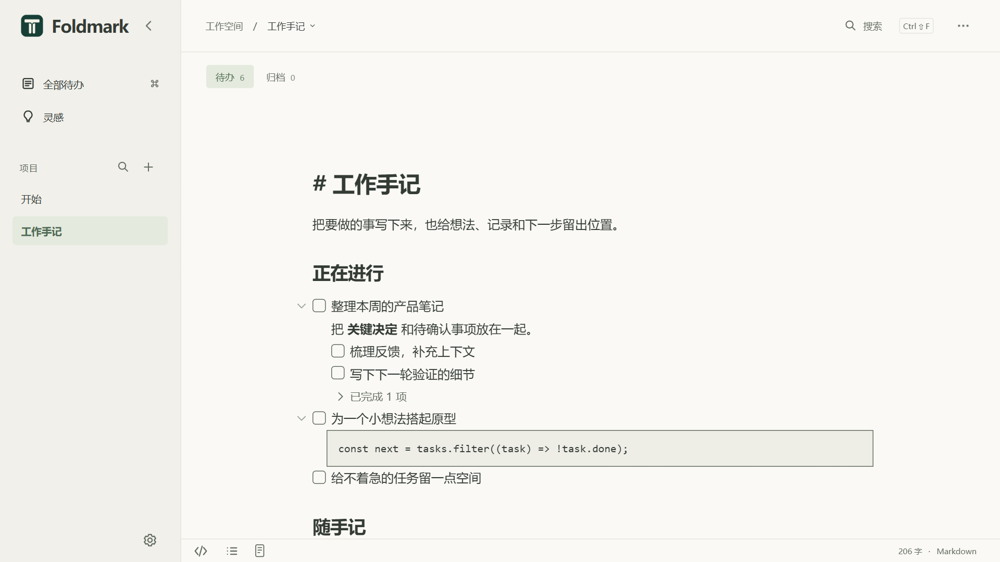

<p align="center">
  
</p>

<h1 align="center">Taskrail</h1>

<p align="center"><strong>用原生 Markdown 管理多项目待办</strong></p>

<p align="center">跨项目查看待办，完成后整组归档，需要时恢复。</p>

<p align="center">
  <a href="https://github.com/Mowonhua/taskrail/releases">下载</a> ·
  <a href="./docs/使用.md">使用指南</a> ·
  <a href="./docs/主题.md">自制主题</a> ·
  <a href="https://github.com/Mowonhua/taskrail/issues">反馈问题</a>
</p>

<p align="center">Windows x64 · Android · 本地文件 · MIT</p>

<p align="center">
  
</p>

## 介绍

一个项目就是一份普通 `.md` 文件。任务、想法和项目记录保留在同一份原文中，其他 Markdown 编辑器也能继续打开。

- **跨项目查看待办**：“全部待办”汇总各项目的任务，搜索结果可直接定位到原文。
- **直接编辑 Markdown**：在正文中编写嵌套任务，保留说明、代码、公式和图片。拖动列表标记可调整同级顺序。
- **完成后整组归档**：父任务及全部子任务完成后，整组任务连同说明移到文件末尾的 `# 归档` 区域。
- **归档后仍可恢复**：点击归档任务的复选框，将整组任务恢复到原章节。

````markdown
# 产品改版

- [ ] 整理反馈

  保留用户原话，以及需要确认的问题。

  - [x] 收集访谈记录
  - [ ] 确认下一步

# 归档

- [x] 完成首轮访谈
````

输入后自动保存。外部修改、文件冲突或保存失败时，应用保留未保存的内容并提供恢复入口。移除项目只移除文件关联。详见[保存与恢复规则](./docs/使用.md#保存外部编辑与恢复)。

## 开始使用

1. 从 [GitHub Releases](https://github.com/Mowonhua/taskrail/releases) 下载并安装 Windows x64 的 `-setup.exe`。
2. 打开应用，点击“新增项目”，关联已有 Markdown 文件或新建清单。
3. 输入 `- [ ]` 创建任务。按 `Enter` 创建下一项；在空任务上再按一次 `Enter` 退出列表。

Windows 版需要 WebView2。设备缺少 WebView2 时，安装程序会联网下载。

Android 版共用编辑与任务规则，使用手机内的 Markdown 副本。电脑与手机可在同一局域网内配对，同步选定项目和灵感簿。详见[手机版与同步](./docs/手机版与同步.md)。

<details>
<summary>编辑、阅读与更新</summary>

- **章节目录**：侧边栏可切换为当前文档的大纲，点击章节直达原文。滚动时，当前章节高亮跟随。
- **灵感簿**：侧栏“灵感”托管一份独立 Markdown 文件，记录项目之外的想法。
- **阅读视图**：预览与分区源码视图可切换。
- **主题**：内置纸面、纯粹双色、新拟物、液态玻璃、磨砂玻璃五套主题。每套主题均有浅色和深色，可跟随系统，也可导入自制 JSON 主题。
- **应用更新**：默认在启动时检查更新并自动下载。“更多操作 → 检查更新”可打开更新面板。点击“安装并重启”后，全部文档和配置保存成功才会开始安装。

[使用指南](./docs/使用.md) · [主题格式](./docs/主题.md) · [自动更新与发布流程](./docs/发布.md)

</details>

## 本地开发

Taskrail 使用 Tauri 2 · Svelte 5 · TypeScript · CodeMirror 6。Windows 开发需要 Node.js、npm、Rust 和 MSVC C++ 构建工具。

```powershell
npm ci
npm run tauri -- dev
```

只预览前端可运行 `npm run dev`。浏览器预览导入的是文件副本；关联原文件和系统文件监听需要桌面版。

<p>
  <a href="https://github.com/Mowonhua/taskrail/actions/workflows/ci.yml"></a>
</p>

[构建、测试与性能采样](./docs/开发.md) · [产品与技术方案](./docs/方案.md)

## 许可证

[MIT License](./LICENSE) · Copyright © 2026 Mowonhua
